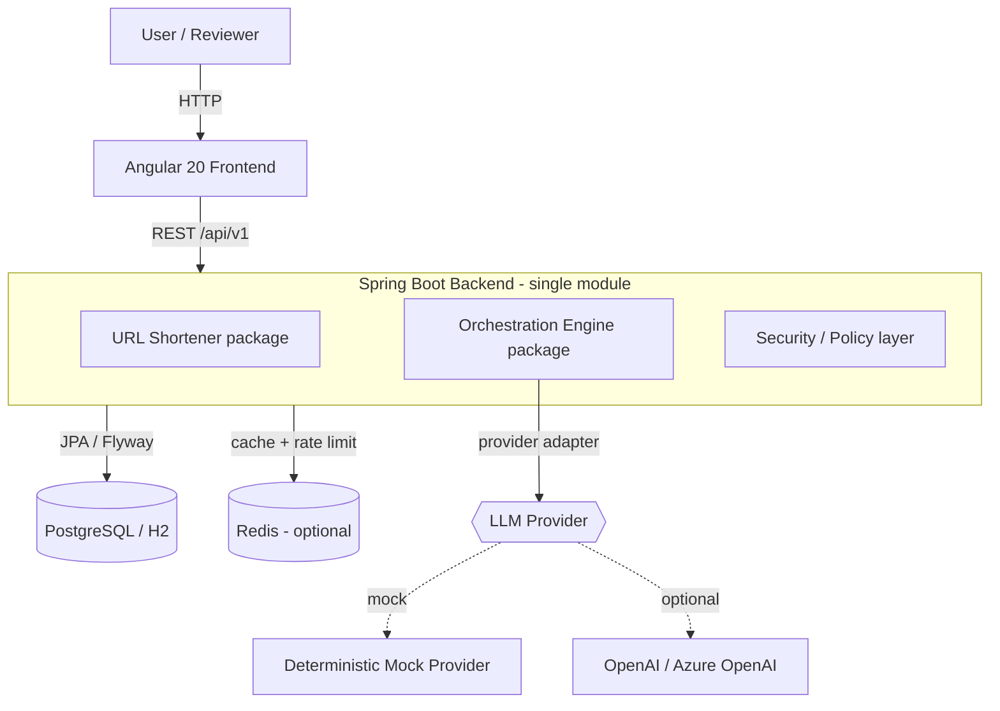
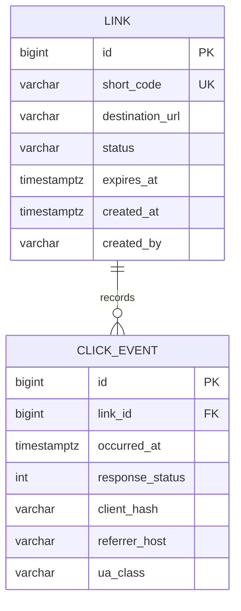
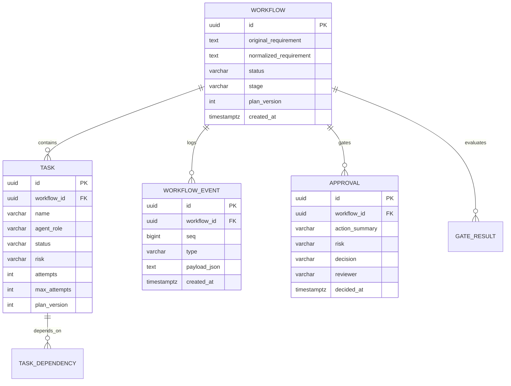
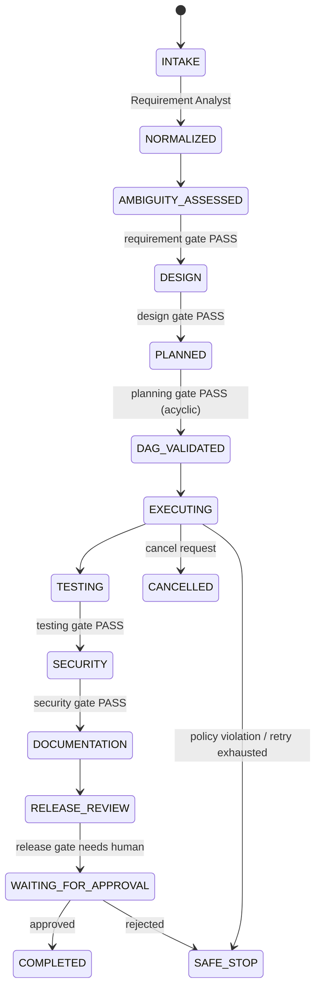
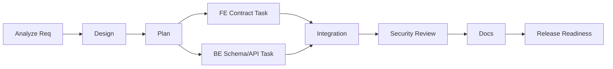

# Architecture — Agentic SDLC Platform

## 1. System context



The backend is one deployable unit with two cohesive domains. H2 is the default
datastore (zero-Docker local dev); PostgreSQL + Redis activate under the `docker`/`prod`
Spring profiles.

## 2. Backend package structure

```
com.agentic.platform
├── common            # error contract, correlation-id filter, pagination, config
├── security          # HTTP security, admin auth, secure headers, CORS
├── urlshortener
│   ├── api           # controllers (links, analytics, redirect)
│   ├── dto           # request/response DTOs (never expose entities)
│   ├── domain        # Link, ClickEvent entities + enums
│   ├── repo          # Spring Data JPA repositories
│   └── service       # code generation, validation, analytics, rate limit
└── orchestration
    ├── api           # workflow, approval, metrics, agents, policies controllers
    ├── dto           # orchestration DTOs
    ├── domain        # Workflow, Task, WorkflowEvent, Approval, Gate entities + enums
    ├── repo          # repositories
    ├── engine        # state machine, DAG, scheduler, gate evaluator
    ├── agent         # agent interfaces + 8 role implementations
    ├── provider      # LlmProvider adapter + MockLlmProvider + OpenAiLlmProvider
    ├── policy        # deterministic policy layer + controlled tool executor
    └── metrics       # reliability metric computation
```

## 3. URL Shortener data model



Indexes: unique on `short_code`; btree on `click_event(link_id, occurred_at)` for
range/daily aggregation; `link(status, expires_at)` for expiry sweeps. Raw IP is
never stored — `client_hash` is a salted, truncated hash (privacy-conscious).

## 4. Orchestration data model



`WORKFLOW_EVENT` is append-only (no update/delete in application code) — the audit
spine. `seq` is a per-workflow monotonic counter for deterministic ordering.

## 5. Orchestration control flow



## 6. Task scheduling (DAG)

The scheduler selects tasks whose dependencies have all `SUCCEEDED`, runs independent
tasks concurrently on a bounded thread pool, and enforces a synchronization barrier
before dependent tasks start. Illegal state transitions are rejected by a central
`StateMachine`. Upstream failure propagates `BLOCKED` to descendants.



`FE Contract` and `BE Schema/API` are independent and execute in parallel after the
planning gate; `Integration` is a barrier that waits for both.

## 7. Trust boundaries

- The **LLM is untrusted**: its output is parsed into structured proposals, never
  executed as instructions. Tool calls route through a deny-by-default executor that
  validates workspace boundaries, command allowlist, timeouts, and output limits.
- **Deterministic code enforces** gates, permissions, approvals, retry limits, and
  state transitions. The LLM may _recommend_ a gate outcome but cannot override it.
- **Humans own** high-impact approvals and final acceptance.

See [security-and-threat-model.md](security-and-threat-model.md) for details.
